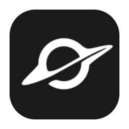
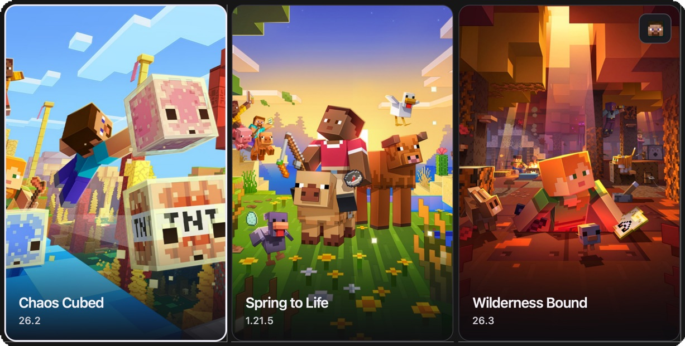
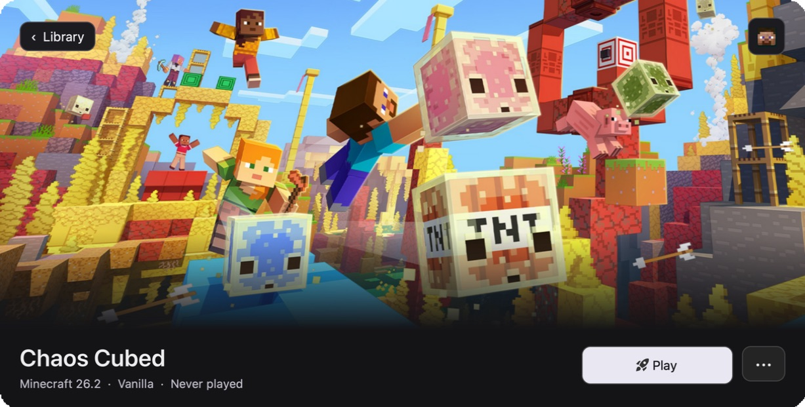
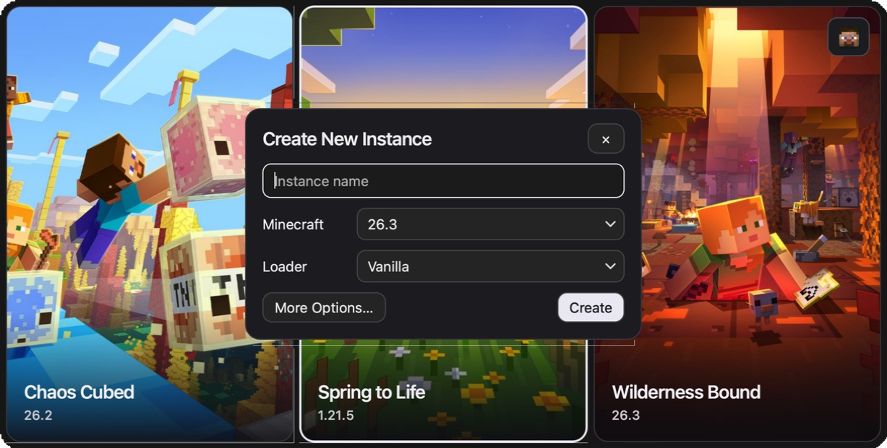
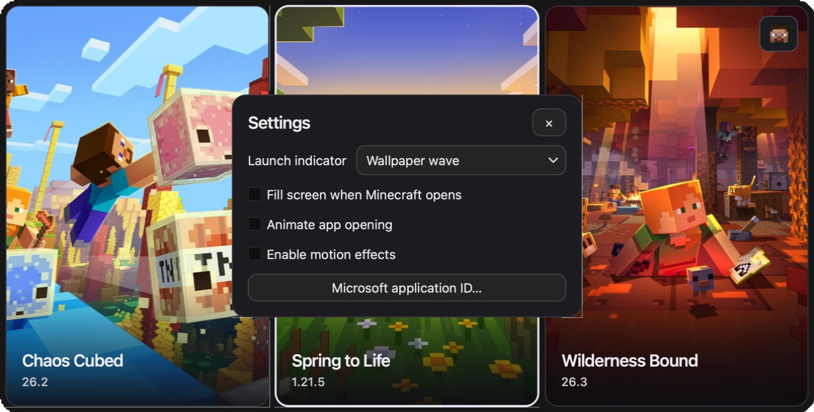

# Stellar Launcher



[Download Stellar Launcher for Apple silicon](https://github.com/sebastianmiletic/archivelauncher/releases/tag/stellar-v1.4.3)



Stellar Launcher is a compact Minecraft Java launcher for macOS based on Prism Launcher. It is an independent fork. It includes Prism’s existing instance and resource managers plus a Stellar theme, live library playtime and a Minecraft version switch that checks matching mods and dependencies.

- **Change Minecraft version** in **Edit → Version**. Select the Minecraft component and choose **Change version**. Review compatible mod downloads after the component change. Stellar reports missing and locked mods so you can review them before launching.
- **Play Minecraft** by opening an instance and selecting **Play**. To link an account, use **Minecraft Accounts → Add Microsoft**. Stellar installs Java and Minecraft directly. Open a saved world from **Edit → Worlds** or **Singleplayer** in Minecraft.
- **Development builds** require a Microsoft application registration approved by Minecraft Services. Enter its application (client) ID when **Add Microsoft** prompts for setup, or provide `ARCHIVE_MSA_CLIENT_ID` at build time. Enable public client flows for personal Microsoft accounts and submit the ID via the [Minecraft API application](https://aka.ms/mce-reviewappid). For browser sign-in, register the Stellar desktop redirect URI `archivelauncher://oauth/microsoft` and, for loopback sign-in, `http://localhost`. Use public client authentication.
- **Stellar Look** adds a fixed black-hole scene with an animated accretion disk on Java 26.3 and grayscale menus to Minecraft Java 1.21.9 through 26.3. Install the pack from **Mods, Packs & Shaders → Install Stellar Look** and enable it in Minecraft’s Resource Packs menu.
- **Updates** use Sparkle on macOS. Stellar checks in the background on startup when automatic updates are enabled. Updates are installed from signed releases. Private GitHub Releases require authentication, so a private repository needs a separately accessible HTTPS feed and download endpoint for Sparkle.

## Stellar Gallery

The gallery and Minecraft launch engine run in one Qt application. Stellar uses its own library under `~/Library/Application Support/Stellar Launcher`.



Scroll past the last wallpaper card to **Create New Instance**, or press Command-N. The quick creator offers Vanilla and Fabric. **More Options** opens snapshots, other loaders, and modpacks. Right-click the create tile for **Import Instance** or **Copy Existing Instance** to bring over existing instances and worlds. Use **Minecraft Accounts** to add, switch, or remove Microsoft accounts. Online sign-in requires a Minecraft-approved Stellar application ID as described above. **Change Skin** opens the in-app editor for the signed-in Microsoft account.

**Settings** in the gallery’s right-click panel (Command-comma) controls opening and hover animations, Minecraft fullscreen, and the launch indicator. The instance wallpaper stays visible while a small progress indicator shows preparation, downloads, and Minecraft startup.

Click a wallpaper card to open its details and Play button. Right-click a card for Play, Edit Instance, Mods, Packs & Shaders, and wallpaper options. The content manager can add local files or browse compatible Modrinth projects. Use the arrow keys to select an instance or the create tile, Return to open it or play from instance details, Shift-F10 for options, and Escape to dismiss the panel.

Stellar matches installed Java releases to official artwork where Minecraft publishes a matching collection. **Wallpapers** lets you choose another image for the selected instance and save the catalogue locally. The release uses manual downloads from this private GitHub repository.

| Instance options | New instance | Settings |
| --- | --- | --- |
|  |  |  |

The separate [Prism appearance release](https://github.com/sebastianmiletic/archivelauncher/releases/tag/stellar-theme-v1.0.0) contains the portable theme for Prism’s management window.

## Play Stellar with Prism

Download [Stellar 1.0.0](https://github.com/sebastianmiletic/archivelauncher/releases/tag/stellar-pack-v1.0.0) and import the `.mrpack` from **Prism → Add Instance → Import**. Sign in to Prism with your Microsoft account that owns Minecraft Java and launch **Stellar**. The pack selects Minecraft 26.3 and Fabric, downloads Lithium from Modrinth, and enables Stellar Look on the new instance. The game and dependencies download through the launcher.

On Java 26.3, the title screen holds a single black hole in frame while the accretion disk flows and the stars twinkle. Minecraft’s **Panorama Scroll Speed** accessibility option controls the motion. The standalone **Stellar Look** resource pack retains a static background on supported earlier versions.

## Build on Apple silicon

Install the dependencies and initialize the git submodule before running the build.

```sh
brew install cmake ninja extra-cmake-modules qtbase qtsvg qtnetworkauth cmark qrencode tomlplusplus libarchive openjdk@17
git submodule update --init --recursive
./tools/archive/build-macos.sh
```

The script builds, tests, and packages the signed app in `../dist/Stellar Launcher.app`. The build accepts `ARCHIVE_MSA_CLIENT_ID`, `ARCHIVE_CURSEFORGE_API_KEY`, `ARCHIVE_UPDATE_FEED_URL` and `ARCHIVE_UPDATE_PUBLIC_KEY`. Set both update variables to enable Sparkle for an independently accessible update feed.

## Release on macOS

Bump the version in `CMakeLists.txt` before building. Keep the private Sparkle update key in the macOS Keychain under the account `archivelauncher`. Use the matching public key in builds. For public GitHub Releases, keep the app’s feed URL pointed to the latest release’s `appcast.xml`. Package the app and feed with `tools/archive/package-update.py` and publish both outputs to the same release. The enclosure must point at the exact tagged ZIP, served over HTTPS. A local Apple ad-hoc signature supports development. A distributed build should use an Apple Developer ID signature and notarization.

Stellar inherits GPL-3.0-only code and contributor notices from Prism Launcher. See [LICENSE](LICENSE), [COPYING.md](COPYING.md), and the [upstream README](README.upstream.md).
