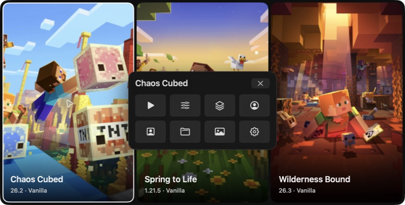
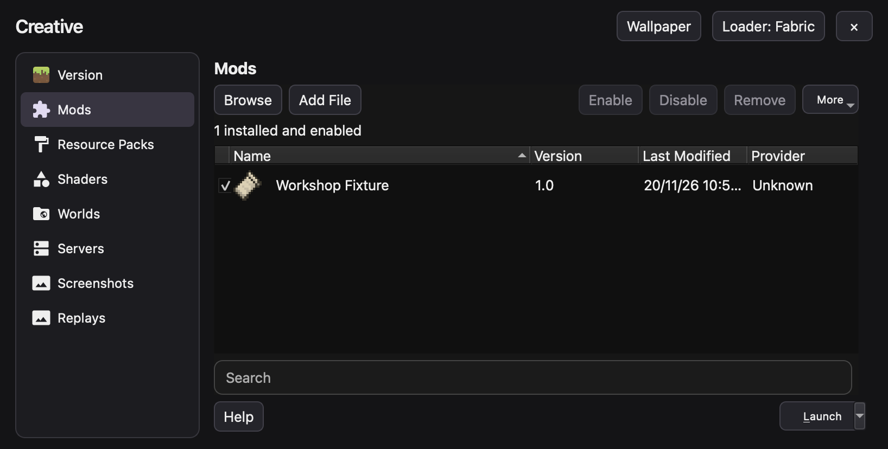
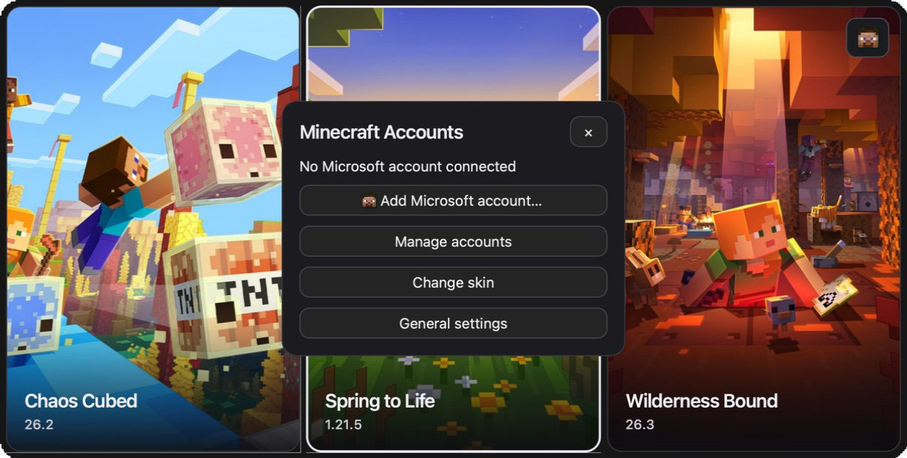
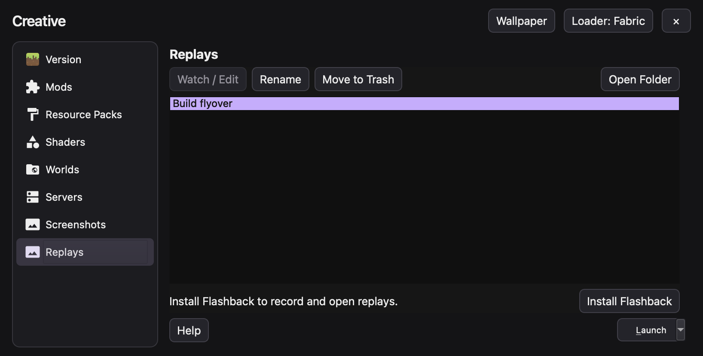
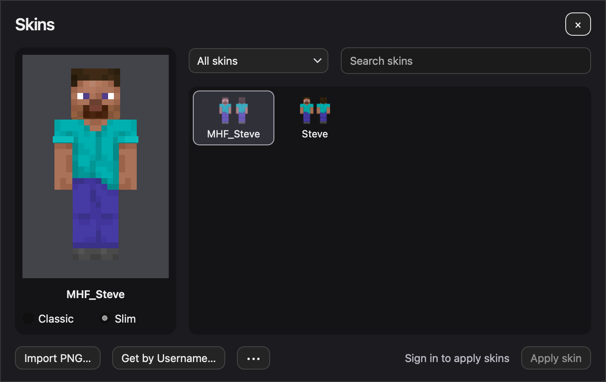

# Stellar Launcher


[Download Stellar Launcher for Apple silicon](https://github.com/sebastianmiletic/stellarlauncher/releases/latest)


Stellar Launcher is a compact Minecraft Java launcher built on Prism Launcher’s open-source engine. Stellar bundles its own engine and manages its own game files, accounts, worlds, and instances. It can look up compatible mods when you change Minecraft versions.

- **Change Minecraft version** in **Edit → Version**. Select the Minecraft component and choose **Change version**. Review compatible mod downloads after the component change. Stellar reports missing and locked mods so you can review them before launching.
- **Play Minecraft** by opening an instance and selecting **Play**. To link an account, use **Minecraft Accounts → Add Microsoft**. Stellar installs Java and Minecraft directly. Open a saved world from **Edit → Worlds** or **Singleplayer** in Minecraft.
- **Stellar Look** adds a fixed black-hole scene with an animated accretion disk on Java 26.3 and grayscale menus to Minecraft Java 1.21.9 through 26.3. Stellar enables the title screen on the first launch of each supported instance. To enable it again, use **General Settings → Use the Stellar Minecraft title screen**.
- **Updates** use Sparkle on macOS. Stellar checks in the background on startup when automatic updates are enabled. Updates are installed from signed releases. Release builds without a configured Sparkle key and feed use manual downloads from GitHub.

## Install

| System | Package |
| --- | --- |
| macOS on Apple silicon | Download the ARM64 ZIP from Releases, extract it, and move **Stellar Launcher.app** into **Applications**. This build uses an ad-hoc signature. |
| macOS on Intel | Download the Intel x86-64 ZIP. Extract it and move the app into **Applications**. |
| Windows | Download the portable ZIP that matches your system (x86-64 or ARM64). Extract the entire ZIP before launching the included executable. |
| Linux | Download the AppImage that matches your system (x86-64 or ARM64). Make the matching file executable with `chmod +x` and open it. The Linux builds use Ubuntu 24.04 runners, so compatibility with older distributions varies. |

[Releases](https://github.com/sebastianmiletic/stellarlauncher/releases) lists published downloads. [Stellar downloads](https://github.com/sebastianmiletic/stellarlauncher/actions/workflows/stellar-downloads.yml) lists build jobs and workflow artifacts.

## Set up Microsoft sign-in

1. In **Microsoft Entra admin center → App registrations**, register **Stellar Launcher** and choose a supported account type that includes **personal Microsoft accounts**.
2. Under **Authentication**, add the **Mobile and desktop applications** platform with the redirect URI `http://localhost`. Turn on **Allow public client flows** for device code sign-in. [Microsoft desktop app registration](https://learn.microsoft.com/en-us/entra/identity-platform/scenario-desktop-app-registration)
3. Open your app registration’s **Overview**. In the [Minecraft Services approval form](https://aka.ms/mce-reviewappid), enter **Application (client) ID** for *Application ID* and **Directory (tenant) ID** for *Tenant ID*. Submit one app registration per form.
4. Once Minecraft Services approves the registration, enter the **Application (client) ID** in **Stellar → Minecraft Accounts → General Settings → Microsoft App ID**. Then choose **Add Microsoft account** and sign in with the personal account that owns Minecraft Java Edition.

The approval requirement applies to both browser and QR/device-code sign-in. Browser sign-in uses PKCE and a loopback callback. Signed-in profiles use the engine’s token refresh and ownership checks. Stellar stores accounts in a user-restricted file in its own data directory.

## In-game tools

For a **Minecraft Java 26.3** instance with **Fabric Loader 0.19.5 or later**, the **Stellar** button appears on Minecraft's title and pause menus.

- **Mods** searches Modrinth for Fabric projects matching the current Minecraft version. It also enables and disables installed mod files. Changes take effect after restarting Minecraft.
- **Shaders** browses Modrinth shader packs and opens the live shader picker when a compatible version of Iris is installed. Search results open their Modrinth project pages.
- **Skins** uses Stellar’s local PNG library. Applying a skin requires a signed-in Minecraft account. Rejoin the world to refresh the applied skin.
- **Resource packs** opens Minecraft’s in-game pack manager.
- **Performance** shows the median and 95th-percentile frame time from up to 240 recent gameplay frames plus the time from the world loading screen to the first playable frame.

## Replays

Open **Edit → Replays** for a Fabric Minecraft Java 26.3 instance. Use **Install Flashback** to download the official Flashback and Fabric API builds from Modrinth. Record within Minecraft. Once a replay is saved, choose **Watch / Edit** to open it in Flashback or rename it and move it to Trash from the launcher. [Flashback project](https://github.com/Moulberry/Flashback)

## Stellar Gallery

The gallery and Minecraft launch engine run in one Qt application. Stellar uses its own library under `~/Library/Application Support/Stellar Launcher`.

The gallery shows up to three instances across, with each card taking the full width when only one instance is visible. Scroll past the last wallpaper card to **Create New Instance**, or press Command-N. The quick creator offers Vanilla and Fabric. With Fabric, it can add compatible stable releases of Sodium, Lithium, and FerriteCore for the selected game version. **More Options** opens snapshots, other loaders, and modpacks. Choose **Import…** on the create tile to pick an installed Prism instance, browse for a Prism/MultiMC folder, or open a modpack archive. Review the exact file list and total size before copying a Prism or MultiMC folder. Archive previews show entries and any Modrinth downloads listed in the pack. Open the **Accounts & Settings** card after Create New Instance to add or switch Microsoft accounts and open settings. Online sign-in requires a Minecraft-approved Stellar application ID as described above. The card shows the active skin and username alongside local playtime and the total instance count. Use **Skins → Get by Username** to import a public Minecraft Java skin, or import a local PNG. The preview rotates to show skins from the front and capes from the back. Applying changes requires a signed-in Minecraft account.

**General Settings** in the account window (Command-comma on macOS) controls motion, Minecraft fullscreen, and the launch indicator. Choose **Wallpaper wave**, **Wallpaper fade**, **Horizontal wipe**, **Iris reveal**, **Subtle progress bar**, or **Status only**.

Drag cards into your preferred order. Use **General Settings** to filter the library by loader. In the same menu on macOS, **Deduplicate identical mods** lets APFS share the storage blocks of matching enabled JARs while keeping each instance independent. Folder imports use the same optimization. Before launching, Stellar warns about recognizable wrong-loader JARs and incompatible Minecraft or Fabric Loader requirements from Fabric metadata.

Click a wallpaper card once to open details, or double-click to launch directly. Right-click an instance and choose **Edit**. Open **Mods**, **Resource Packs** (called **Texture Packs** in older versions), or **Shaders**. Use **Browse** or **Add File** to install content. Select an item to enable, disable, or remove it. Update, version, and folder actions are under **More**. The editor header has wallpaper and loader controls. General Settings opens in a matching window with separate launcher accent, Minecraft title, and black hole disk colors. Each instance can launch independently. The running instance’s Play control becomes **Running · Stop…**. Use the arrow keys to select an instance or the create tile, Return to open it or play from instance details, Shift-F10 for options, and Escape to dismiss the panel.

Stellar matches installed Java releases to the highest-resolution official artwork available for that release. Wallpapers render at the screen’s pixel density, up to the original image resolution. Open **Wallpaper** from an instance to browse visual previews. **Upload** adds a PNG, JPEG, WebP, or GIF to **My Wallpapers** at its original resolution (up to 64 MB and 48 megapixels). Animated wallpapers pause when Stellar is hidden, minimized or in the background. Turn on **Shuffle this collection** to choose a wallpaper each time you open an instance. The library uses still previews, and disabling motion also pauses GIF playback when opening details.

| Instance options | Instance editor |
| --- | --- |
|  |  |

| Accounts & Settings | General settings |
| --- | --- |
|  |  |

| Flashback replays | Skin library |
| --- | --- |
|  |  |

The separate [Prism appearance release](https://github.com/sebastianmiletic/stellarlauncher/releases/tag/stellar-theme-v1.0.0) contains the portable theme for Prism’s management window.

## Play Stellar with Prism

Download [Stellar 1.0.0](https://github.com/sebastianmiletic/stellarlauncher/releases/tag/stellar-pack-v1.0.0) and import the `.mrpack` from **Prism → Add Instance → Import**. Sign in to Prism with your Microsoft account that owns Minecraft Java and launch **Stellar**. The pack selects Minecraft 26.3 and Fabric, downloads Lithium from Modrinth, and enables Stellar Look on the new instance. The game and dependencies download through the launcher.

On Java 26.3, the title screen holds a single black hole in frame while the accretion disk flows and the stars twinkle. Minecraft’s **Panorama Scroll Speed** accessibility option controls the motion. The standalone **Stellar Look** resource pack retains a static background on supported earlier versions.

## Build on Apple silicon

Install the dependencies and initialize the git submodule before running the build.

```sh
brew install cmake ninja extra-cmake-modules qtbase qtsvg qtnetworkauth cmark qrencode tomlplusplus libarchive openjdk@17
git submodule update --init --recursive
./tools/archive/build-macos.sh
```

The script builds, tests, and packages the signed app in `../dist/Stellar Launcher.app`. The build accepts `ARCHIVE_MSA_CLIENT_ID`, `ARCHIVE_CURSEFORGE_API_KEY`, `ARCHIVE_UPDATE_FEED_URL` and `ARCHIVE_UPDATE_PUBLIC_KEY`. Set both update variables to enable Sparkle for an independently accessible update feed.

## Release on macOS

Bump the version in `CMakeLists.txt` before building. Keep the private Sparkle update key in the macOS Keychain under the account `archivelauncher`. Use the matching public key in builds. For public GitHub Releases, keep the app’s feed URL pointed to the latest release’s `appcast.xml`. Package the app and feed with `tools/archive/package-update.py` and publish both outputs to the same release. The enclosure must point at the exact tagged ZIP, served over HTTPS. A local Apple ad-hoc signature supports development. A distributed build should use an Apple Developer ID signature and notarization.

Stellar inherits GPL-3.0-only code and contributor notices from Prism Launcher. See [LICENSE](LICENSE), [COPYING.md](COPYING.md), and the [upstream README](README.upstream.md).
